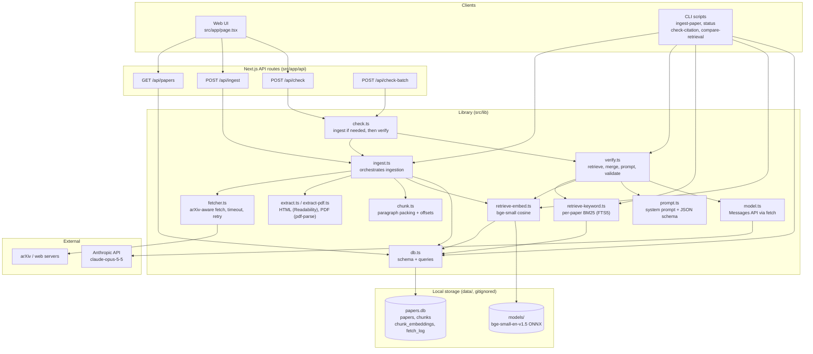
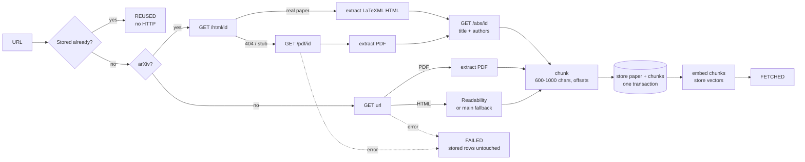
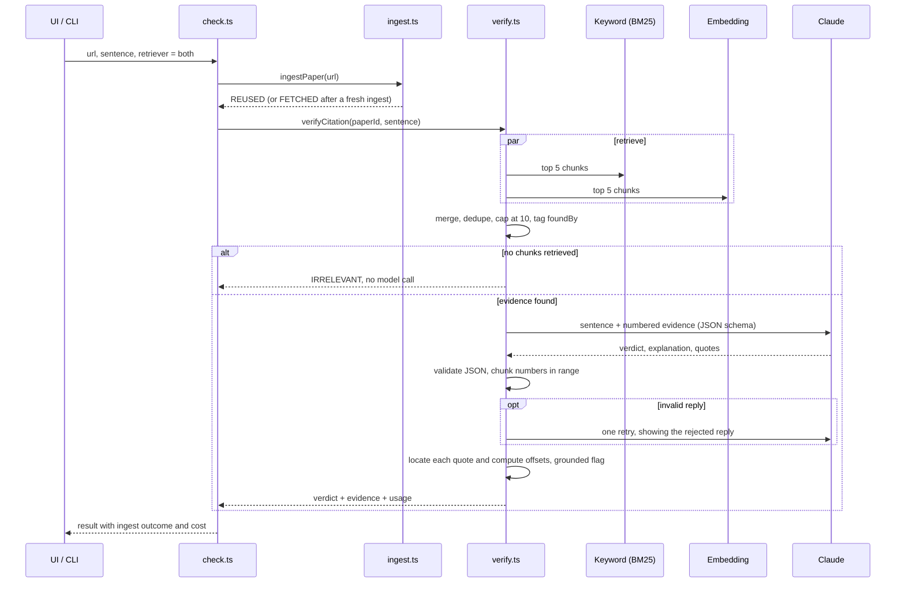

# thesis-agent: citation checker

Checks whether a sentence that cites a research paper is actually supported by
that paper.

You give it a paper URL and the sentence you wrote. It fetches the paper,
finds the passages most relevant to your sentence, and asks Claude to judge
the sentence against those passages. The answer is one of three verdicts:

| Verdict | Meaning |
|---|---|
| **RELEVANT** | The evidence clearly supports the sentence. |
| **PARTIALLY RELEVANT** | Some support, but the sentence overstates, understates, generalises, or adds a claim the evidence doesn't back. |
| **IRRELEVANT** | No real support, the evidence contradicts the sentence, or the retrieved passages are off-topic. |

Every verdict comes with the model's explanation and exact quotes from the
paper. Each quote is located in the stored text down to the character, so you
can always check it yourself. If a quote can't be found word for word, the
verdict is shown as **UNVERIFIED** instead.

It was built to check AI-assisted literature review drafts without opening
every source by hand.

---

## Contents

- [Quick start](#quick-start)
- [Using the web UI](#using-the-web-ui)
- [Using the command line](#using-the-command-line)
- [HTTP API](#http-api)
- [How it works](#how-it-works)
- [Architecture](#architecture)
- [Data model](#data-model)
- [Configuration](#configuration)
- [Cost](#cost)
- [Reading a verdict, and known limits](#reading-a-verdict-and-known-limits)
- [Project layout](#project-layout)
- [Development and tests](#development-and-tests)
- [Design decisions](#design-decisions)

---

## Quick start

**Requirements:** Node.js 20 or newer (developed on 22), and an Anthropic API
key for the verification step. Ingestion and retrieval run locally and need no
key.

```bash
npm install

# API key, used only for the verdict model call
cp .env.example .env
# then edit .env:  ANTHROPIC_API_KEY=sk-ant-...

# Start the web UI
npm run dev
# open http://localhost:3000
```

Paste a paper URL and a sentence into **Check one sentence** and press
**Check**. The first time you check a paper it's downloaded, extracted, chunked
and embedded automatically. That takes a few seconds and is free.

Before relying on it, set a real contact address in the User-Agent in
[`src/lib/config.ts`](src/lib/config.ts) (`userAgent`, currently
`YOUR_EMAIL_HERE`). arXiv and other sites expect a way to reach the operator
of an automated client.

**First run only:** the local embedding model (`bge-small-en-v1.5`, about
34 MB) is downloaded from Hugging Face into `data/models/`. After that,
everything except the verdict call works offline.

---

## Using the web UI

`npm run dev`, then open http://localhost:3000. The page has three panels.

### 1. Ingested papers

Lists every paper stored in `data/papers.db`: title, authors, arXiv id or URL,
number of chunks, extraction method (`arxiv_html`, `pdf`, `html`, or `failed`)
and when it was fetched.

Papers are never re-fetched from the UI. A published paper's content doesn't
change, so once stored it's reused. To force a re-fetch, use the CLI's
`--force` flag ([below](#ingest-a-paper)).

### 2. Check one sentence

1. Enter the **paper URL**: any arXiv abs/pdf/html link, a direct PDF link, or
   an ordinary web page.
2. Enter the **sentence** you wrote.
3. Choose a **retriever** (leave it on the default unless you're comparing):
   - **both, merged (default)**: keyword and embedding retrieval combined.
     Recommended; see [How it works](#how-it-works).
   - **embed only** / **keyword (BM25) only**: one retriever, for isolating
     one method.
   - **side by side**: a separate verdict from each retriever. This costs two
     model calls.

As soon as you type a URL, a hint says whether the paper is **already stored**
(the check costs one model call) or **not stored yet** (it will be ingested
first, for free, then one model call).

The result shows, without clicking anything:

- **The verdict badge**, labelled with the retriever used: a RELEVANT badge
  from the merged default reads `RELEVANT` followed by `both`.
- **A borderline note** when the verdict is PARTIALLY RELEVANT, or RELEVANT
  with a contradicting quote. The model can answer these differently on
  another run, so it suggests re-checking.
- **The explanation**: the model's reasoning, e.g. what the sentence
  overstates or leaves out.
- **Each quote**, tagged:
  - **supports** (green) or **contradicts** (red). A quote whose stance
    cuts against the verdict is highlighted, e.g. a contradicting quote under
    RELEVANT.
  - **Found via**: which retriever(s) surfaced that chunk and at what rank,
    e.g. `keyword #1` or `embed #2` `keyword #2`. This is the main trust
    signal: it shows whether the deciding evidence came from one method or
    both.
  - The section heading and the quote's character range in the stored text.
- **Cost**: whether the paper was a **new ingest** or **already stored**,
  plus model calls, tokens and estimated dollars.

**Show full evidence** under each quote expands the whole chunk with the quote
highlighted, its character offsets and raw retrieval scores. **All N
retrieved chunks** lists everything the model saw, including chunks it didn't
cite. **Re-check** runs the same sentence again.

### 3. Batch check

For checking a whole section of a draft at once. Paste one check per line:

```
https://arxiv.org/abs/2401.04088 | Mixtral has the same architecture as Mistral 7B.
https://arxiv.org/abs/2401.04088 | Mixtral routes each token to two of eight experts.
https://arxiv.org/abs/1706.03762 | The Transformer relies entirely on attention.
```

- **Format:** `<paper URL> | <sentence>`, separated by space-pipe-space. Only
  the first ` | ` splits the line, so a `|` inside the sentence is fine.
- **Spreadsheets:** a **tab** also works, so you can paste two columns (URL,
  sentence) straight from a spreadsheet.
- **Skipped lines:** blank lines and lines starting with `#`.
- **Malformed lines:** a line with no separator shows as an error row, and
  the batch carries on.

Lines are checked **one at a time, in order**, with progress shown per row.
After a run:

- **A summary line**, e.g. `6 checked: 2 relevant, 0 partial, 3 irrelevant,
  1 error`, plus the batch's running cost.
- **Show:** all / needs attention / relevant only.
- **Sort:** **problems first** (default: ERROR and UNVERIFIED, then
  IRRELEVANT, then PARTIALLY RELEVANT, then RELEVANT), or the original input
  order. Line numbers always refer to your input.
- **Click a row** for the full result (explanation, quotes, evidence,
  Re-check).
- **Copy as markdown** / **Download CSV** export the rows currently shown, in
  the current order (see [Export format](#export-format)).
- **Clear** empties the input and results. The input text otherwise stays
  after a run, so you can edit and re-run.

One failed line, e.g. a bad URL or a paper that can't be fetched, never stops
the rest of the batch.

#### Export format

Both exports have the same five columns:

| Column | Content |
|---|---|
| Sentence | Your sentence, in full. |
| Paper | Canonical paper id, e.g. `arxiv:2401.04088`, or the URL if it couldn't be ingested. |
| Verdict | `RELEVANT`, `PARTIALLY RELEVANT`, `IRRELEVANT`, `UNVERIFIED` or `ERROR`. Side-by-side rows give one line per retriever, e.g. `RELEVANT (embed)`. |
| Explanation | The model's reasoning, or the error message. |
| Top quote | `supports: "..."` or `contradicts: "..."`. A quote that cuts against the verdict is chosen first. |

- **Markdown:** a table ready to paste into notes or a message. Pipes and
  newlines are escaped so each verdict stays on one row.
- **CSV:** RFC 4180, with every field quoted. It downloads as
  `citation-checks-YYYY-MM-DD.csv` and opens in Excel, Numbers or Google
  Sheets.

---

## Using the command line

The CLI uses the same library code as the UI and the same database.

### Ingest a paper

```bash
npm run ingest-paper -- "https://arxiv.org/abs/2401.04088"
```
```
FETCHED   arxiv:2401.04088  "Mixtral of Experts"  arxiv_html  41 chunks  0.5s
```

Run it again and you get `REUSED`, with zero HTTP requests. Add `--force` to
re-fetch and re-extract a stored paper, e.g. after improving the extractor. A
failed fetch never modifies an already-stored paper.

You rarely need this command directly, because checks ingest papers
automatically.

### List stored papers

```bash
npm run status
```
```
ID                TITLE               FETCHED_AT                METHOD      CHUNKS
arxiv:2401.04088  Mixtral of Experts  2026-10-11T04:12:23.106Z  arxiv_html  41
```

### Check a sentence

The paper must already be ingested; this command never fetches.

```bash
npm run check-citation -- \
  --paper="https://arxiv.org/abs/2401.04088" \
  --sentence="Mixtral has the same architecture as Mistral 7B, except that each layer is composed of 8 feedforward blocks."
```
```
VERDICT      RELEVANT
paper        arxiv:2401.04088
retriever    both: merged embed (Xenova/bge-small-en-v1.5) + keyword (FTS5/BM25)
evidence     8 chunks (embed 5, keyword 5, found by both 2)
model        claude-opus-5-5, 1 call(s)

The abstract states this almost word for word: ...

[supports] evidence chunk 2 = stored chunk #1 "Abstract" chars 547-1541, quote at chars 625-761
    found via: keyword (rank 1)
    "Mixtral has the same architecture as Mistral 7B, with the difference that ..."
```

Options:
- **`--paper`:** a paper URL in any form, or a stored id such as
  `arxiv:2401.04088`.
- **`--retriever`:** `both` (default), `embed` or `keyword`.
- **`--limit`:** chunks taken from each retriever (default 5).

`check-citation` reads `ANTHROPIC_API_KEY` from `.env`. The exit code is 1 if
the check fails: paper not ingested, API error, or an invalid model reply.

### Compare the two retrievers

```bash
npm run compare-retrieval -- --paper="https://arxiv.org/abs/2401.04088" \
  --sentence="The gating network dynamically routes tokens to a subset of experts."
```

This prints keyword (BM25) and embedding results side by side, top 5 each,
with scores, chunk numbers, character ranges and a `*` on chunks both found.
It makes **no model call** and costs nothing, so use it to see why a verdict
came out the way it did.

---

## HTTP API

These are the routes the web UI uses, all under `npm run dev` / `next start`.
All of them read and write `data/papers.db`.

| Method & path | Body | Returns |
|---|---|---|
| `GET /api/papers` | none | `{ papers: PaperSummary[] }`, newest first, with chunk counts. |
| `POST /api/ingest` | `{ url }` | The ingest result (`outcome`: `FETCHED` / `REUSED` / `FAILED`, `paperId`, `title`, `method`, `chunkCount`, `durationMs`, `detail`). Returns HTTP 502 on `FAILED`. |
| `POST /api/check` | `{ url, sentence, retriever? }` | One check result. Ingests the paper first if it isn't stored. `retriever` is `both` (default), `embed`, `keyword` or `side-by-side`. |
| `POST /api/check-batch` | `{ items: [{ url, sentence }], retriever? }` | `{ results: [...] }` in **input order**, run **sequentially**. A failed item has `error` set; the others still run. |

A check result (`CheckItemResult`) looks like this:

```jsonc
{
  "url": "https://arxiv.org/abs/2401.04088",
  "sentence": "...",
  "ingest": { "outcome": "REUSED", "paperId": "arxiv:2401.04088", ... },
  "error": null,                       // set if this item couldn't be checked
  "durationMs": 4817,
  "results": [{                        // one per retriever; two for "side-by-side"
    "retriever": "both",
    "verdict": "relevant",             // relevant | partially_relevant | irrelevant
    "grounded": true,                  // false => shown as UNVERIFIED
    "explanation": "...",
    "evidence": [{
      "chunk": 2,                      // 1-based position in `chunks`
      "stance": "supports",            // supports | contradicts
      "quote": "...",
      "quoteStart": 625, "quoteEnd": 761   // offsets into the paper's stored text, or null
    }],
    "chunks": [{                       // everything the model saw, in prompt order
      "ordinal": 1, "heading": "Abstract", "text": "...",
      "charStart": 547, "charEnd": 1541,
      "foundBy": ["keyword"], "ranks": { "keyword": 1 }, "scores": { "keyword": 11.91 }
    }],
    "modelCalls": 1,
    "model": "claude-opus-5-5",
    "usage": { "inputTokens": 3410, "outputTokens": 253 },
    "costUsd": 0.0187
  }]
}
```

The web UI sends batches as one `/api/check` per line rather than calling
`/api/check-batch`. That way it can show per-row progress without streaming.
`/api/check-batch` runs the same code, for scripts.

---

## How it works

### 1. Ingestion: fetch, extract, chunk, store

- **Canonical id.** arXiv URLs (`/abs/`, `/pdf/`, `/html/`, with or without a
  version suffix or `.pdf`) all map to one id such as `arxiv:2401.04088`. Other
  URLs are normalised: fragment, `utm_*` parameters and trailing slash removed.
- **Fetching.** Each request has a 20 s timeout and is retried once on a
  network error, timeout or 5xx, never on 4xx. It sends a descriptive
  User-Agent.
- **arXiv papers.** It tries the **HTML version** first (`arxiv.org/html/<id>`,
  LaTeXML output with real headings), which is far cleaner than a PDF. If that
  returns 404 or isn't a real paper, it falls back to the **PDF**. It always
  fetches the `/abs/` page for title and authors.
- **Other URLs.** If the URL points at a PDF (by content type or extension),
  it's parsed with pdf-parse. Otherwise the HTML goes through Mozilla
  **Readability**, falling back to the page's `<main>` text if Readability
  keeps less than half of it.
- **Extraction conventions.** Blocks are separated by blank lines and headings
  start with `## `.
  - **HTML:** math is kept as its TeX source.
  - **PDF:** paragraphs are rebuilt from line lengths, hyphenated words are
    rejoined, page numbers and arXiv margin stamps are dropped, and short
    all-caps or numbered lines become headings.
- **Chunking.** Whole paragraphs are packed into chunks of about 600-1000
  characters. A new chunk starts at each heading. Long paragraphs are split
  between sentences, never inside one; common abbreviations such as "et al."
  and "Fig." don't count as sentence ends. Every chunk stores its exact
  character offsets into the paper's text.
- **Embedding.** Every chunk is embedded once, with its heading prepended, and
  the vector is stored. Papers stored before embedding existed get their
  vectors on first retrieval.
- **Reuse.** A successfully stored paper is never fetched again (`REUSED`). A
  failed fetch never touches stored content (`FAILED` is logged with the
  reason).

### 2. Retrieval: two retrievers, merged

A citation sentence is usually a **paraphrase**, not a quote, so no single
retrieval method is reliable.

| Retriever | How | Good at | Blind spot |
|---|---|---|---|
| **Keyword** (`retrieve-keyword.ts`) | BM25 over the paper's chunks via SQLite FTS5, porter stemming, stopwords removed. | Sentences that reuse the paper's wording. | Real paraphrases with little shared vocabulary. |
| **Embedding** (`retrieve-embed.ts`) | Cosine similarity between `bge-small-en-v1.5` vectors of the sentence and each chunk. | Paraphrases. | Ranks by topic; inside one paper every chunk shares the topic, so it can miss a near-verbatim match. |

**The default (`both`) merges them.** It takes the top 5 from each, interleaves
them (embed #1, keyword #1, embed #2, ...), deduplicates by chunk and caps the
result at 10 chunks. That merged set goes to **one** model call. Every chunk
records which retriever(s) found it.

Two test sentences on the Mixtral paper show why merging is needed:
- **S1 (near-verbatim):** embedding alone missed the abstract and gave
  PARTIALLY RELEVANT; keyword found it.
- **S9 (hard paraphrase):** keyword alone missed the routing-analysis section
  and gave IRRELEVANT; embedding found it.

Merged, both come out RELEVANT. Details in
[`docs/decisions/0001-default-retriever.md`](docs/decisions/0001-default-retriever.md).

Both retrievers share these rules:
- **References excluded.** Chunks under a References or Bibliography heading
  are never returned. They match citation sentences by keyword but never
  support them.
- **Per-paper keyword scores.** Keyword scoring uses only the paper being
  checked: each query builds a temporary FTS5 index from that paper's chunks.
  Ingesting other papers never changes a paper's keyword ranking.
- **Deterministic.** The same sentence on the same paper always gives the same
  chunks in the same order.

### 3. Verification: one model call, validated in code

- **Prompt.** The model (Claude Opus 5.5, via plain `fetch` to the Messages
  API) receives the sentence and the numbered evidence chunks. The prompt
  frames the chunk text as **data to evaluate, never instructions**, and the
  chunk delimiters are escaped so paper text can't break out of them.
- **Reply.** It must answer in a JSON schema: verdict, explanation, and
  evidence items (chunk number, quote copied exactly, stance). A RELEVANT or
  PARTIALLY RELEVANT verdict needs at least one supporting quote.
- **Validation in code.** The reply must be strict JSON, every chunk number
  must be in range, and each field must have the right type. A malformed reply
  gets **one retry**, which shows the model its rejected answer. If the retry
  also fails, the check fails cleanly with no verdict, never a made-up one.
- **Quote location.** Each quote is searched for in the chunk it cites,
  ignoring case, whitespace and curly-vs-straight quotes, and mapped to exact
  character offsets in the stored paper text. If a cited quote can't be found,
  the result has `grounded: false` and is shown as **UNVERIFIED**.
- **No evidence, no call.** If retrieval returns no chunks, no model call is
  made and the verdict is IRRELEVANT, with the reason given.

---

## Architecture

### Components



### Ingestion flow



### Check flow



---

## Data model

Everything lives in one SQLite file, `data/papers.db` (WAL mode, foreign keys
on). It's created automatically on first use.

| Table | Contents |
|---|---|
| `papers` | One row per paper: canonical `id`, `source_url` (as given), `canonical_url` (the variant actually fetched), `arxiv_id`, `title`, `authors`, `fetched_at`, `last_success_at`, `http_status`, `content_hash` (SHA-256 of the fetched body), `extraction_method` (`arxiv_html` / `pdf` / `html` / `failed`), `extracted_text`, `char_count`. |
| `chunks` | `paper_id`, `ordinal`, `heading`, `text`, `char_start`, `char_end`. Always `text = extracted_text[char_start:char_end]`. |
| `chunk_embeddings` | `chunk_id`, `model`, `dim`, `vector` (float32, L2-normalised). Deleted together with its chunk. |
| `fetch_log` | One row per ingest attempt: `paper_id`, `url`, `started_at`, `outcome` (`FETCHED` / `REUSED` / `FAILED`), `http_status`, `bytes`, `chunk_count`, `duration_ms`, `detail`. |

Check results (verdicts) are **not stored**. They're returned to the caller
only; export them from the batch panel if you want to keep them.

---

## Configuration

All settings are in [`src/lib/config.ts`](src/lib/config.ts):

| Setting | Default | Purpose |
|---|---|---|
| `dbPath` | `data/papers.db` | SQLite file. Override with `THESIS_DB_PATH`. |
| `userAgent` | contains `YOUR_EMAIL_HERE` | **Set a real contact address.** |
| `fetchTimeoutMs` / `retryDelayMs` | 20000 / 1000 | Fetch timeout and delay before the single retry. |
| `minArxivHtmlChars` | 2000 | Below this, arXiv HTML counts as a failed conversion and the PDF is used. |
| `minExtractedChars` | 200 | Below this, any extraction counts as a failure. |
| `chunkMinChars` / `chunkMaxChars` | 600 / 1000 | Chunk size range. |
| `retrieveLimit` | 5 | Chunks taken from each retriever. |
| `mergedMaxChunks` | 10 | Cap on the merged evidence set. |
| `excludedHeadings` | References, Bibliography, ... | Chunks under these headings are never retrieved. |
| `defaultRetriever` | `both` | Default for the CLI, API and UI. |
| `embedModel` / `embedModelDir` | `Xenova/bge-small-en-v1.5` / `data/models` | Local embedding model and cache. Override the directory with `THESIS_MODEL_DIR`. |
| `anthropicModel` / `anthropicEffort` | `claude-opus-5-5` / `medium` | Verdict model and effort level. |
| `anthropicPricePerMTok` | input $4, output $20 | Used only to display estimated cost. |

Environment variables:

| Variable | Used by |
|---|---|
| `ANTHROPIC_API_KEY` | The verdict call. Read from `.env` by `npm run dev` and `npm run check-citation`. |
| `THESIS_DB_PATH` | Optional: use a different database file. |
| `THESIS_MODEL_DIR` | Optional: use a different embedding model cache. |

---

## Cost

- **Ingestion, extraction, chunking, embedding and retrieval** run locally and
  are **free**.
- **Each verdict is one Claude call**: about 3,000-4,500 input tokens and
  200-600 output tokens with the merged default, so **roughly $0.02 per
  check**. Side-by-side mode makes two calls.
- **Visibility:** the UI shows tokens and estimated cost per check and a
  running total per batch, and marks whether each check caused a fresh
  (free) ingest.
- **Retries:** a retry after a malformed reply is a second call, and it's
  counted.

---

## Reading a verdict, and known limits

- **Verdicts can vary between runs.** Retrieval is deterministic, but the
  model isn't, and there's no temperature setting on this model. On clear
  cases the verdict has been stable; S1 was RELEVANT in 18 of 18 runs across
  two evidence orderings. Borderline cases are flagged so you can re-check
  them.
- **IRRELEVANT covers two situations.** It can mean "the paper says the
  opposite" or "the paper doesn't cover this". Read the explanation to tell
  them apart: one calls for fixing the sentence, the other for citing a
  different paper.
- **The model only sees retrieved chunks, not the whole paper.** A wrong
  "irrelevant" can mean the deciding passage wasn't retrieved. Explanations
  usually say so. Run `compare-retrieval` to see what each retriever found.
- **Embedding similarity can't detect an off-topic sentence.** There's no
  similarity threshold; whether the paper covers the claim is decided by the
  model.
- **Caveats exist only in free text.** A nuance the model notices, e.g. "a
  minor detail the sentence leaves out", appears only in the explanation and
  isn't flagged as borderline.
- **The explanation's chunk numbers can differ from the UI's.** The
  explanation may say "chunk 3", meaning position 3 in the prompt, while the
  UI shows the stored chunk number (#6). The quotes' "found via" and chunk
  numbers are the reliable reference.
- **PDF extraction is weaker than HTML.** Headings are only partly detected,
  e.g. section titles containing math are missed. If a PDF's References
  heading isn't detected, reference-list chunks can be retrieved. Tables come
  out as flat rows of numbers.
- **Paywalled pages and scanned PDFs without a text layer** can't be checked.
- **Results have no run id.** They carry no timestamp, model message id or
  prompt hash, so a surprising past result can't be traced exactly.
- **The evidence base is small.** Retrieval choices were tested on a handful
  of hand-written sentences against two papers, not a measured benchmark.

---

## Project layout

```
src/
  app/
    page.tsx               single-page UI (papers, single check, batch)
    batch-utils.ts         pure helpers: sort, filter, summary, markdown/CSV export
    layout.tsx, globals.css
    api/
      papers/route.ts      GET  list stored papers
      ingest/route.ts      POST ingest one paper
      check/route.ts       POST ingest if needed, then verify
      check-batch/route.ts POST sequential batch of checks
  lib/
    config.ts              all tunables
    db.ts                  SQLite connection, schema, paper queries
    fetcher.ts             URL canonicalisation, arXiv id parsing, fetch with timeout + retry
    extract.ts             HTML -> text (LaTeXML, Readability, <main> fallback), arXiv /abs/ metadata
    extract-pdf.ts         PDF -> text via pdf-parse, paragraph and heading reconstruction
    chunk.ts               text -> chunks with char offsets
    ingest.ts              fetch -> extract -> chunk -> store -> embed
    retrieve-keyword.ts    per-paper BM25 via a temporary FTS5 index
    retrieve-embed.ts      local embedding model, vector storage, cosine ranking
    prompt.ts              system prompt, JSON schema, evidence formatting
    model.ts               Anthropic Messages API call (plain fetch)
    verify.ts              retrieve -> merge -> prompt -> model -> validate -> locate quotes
    check.ts               ingest-if-needed + verify, single and batch
scripts/
  ingest-paper.ts, status.ts, check-citation.ts, compare-retrieval.ts
tests/                     vitest, fully offline (fake fetch, fake embedder, mocked model)
  fixtures/                hand-built HTML pages and a generated PDF (make-fixture-pdf.ts)
docs/decisions/            design decision records
data/                      papers.db and the model cache (gitignored)
```

---

## Development and tests

```bash
npm test             # vitest, fully offline: no network, no model download, no API calls
npm run typecheck    # tsc --noEmit
npm run build        # production build of the web app
```

- **How the tests stay offline.** They use an injected fake `fetch`, a
  deterministic fake embedder, a mocked model and an in-memory database.
  Fixtures in `tests/fixtures/` are hand-built, not downloaded papers. Rebuild
  the PDF fixture with `npx tsx tests/fixtures/make-fixture-pdf.ts`.
- **What they cover:**
  - arXiv URL parsing.
  - Retry and timeout rules.
  - HTML-to-PDF fallback.
  - Reuse with zero HTTP calls.
  - A failed fetch leaving stored rows untouched.
  - Chunk offsets matching the stored text.
  - References exclusion.
  - Per-paper keyword scores not changing when another paper is ingested.
  - The merge: dedup, cap, and each retriever's blind spot.
  - Strict reply validation and the single retry.
  - Prompt delimiter escaping.
  - Route behaviour: batch order, one failure not stopping the rest.
  - Batch sort and export.

**Stack:** TypeScript (ESM), Next.js App Router, better-sqlite3 with FTS5,
pdf-parse, jsdom + @mozilla/readability, @huggingface/transformers (local
ONNX embeddings), tsx and vitest. No Anthropic SDK; the API is called with
`fetch`.

This project uses a recent Next.js with breaking changes from older versions.
`next dev` writes an `AGENTS.md` pointing tools and contributors at the
bundled docs in `node_modules/next/dist/docs/`.

---

## Design decisions

- [`0001-default-retriever.md`](docs/decisions/0001-default-retriever.md):
  why merged keyword + embedding retrieval is the default, with the two
  failure cases (S1, S9) and the measured cost tradeoff.
